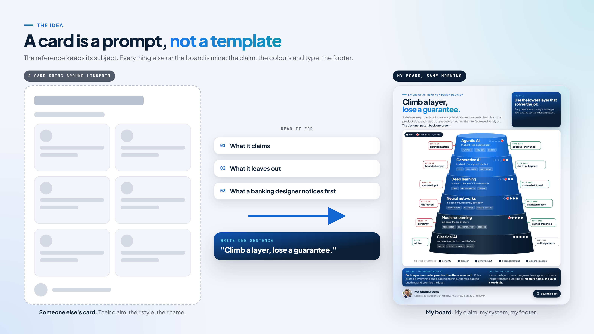
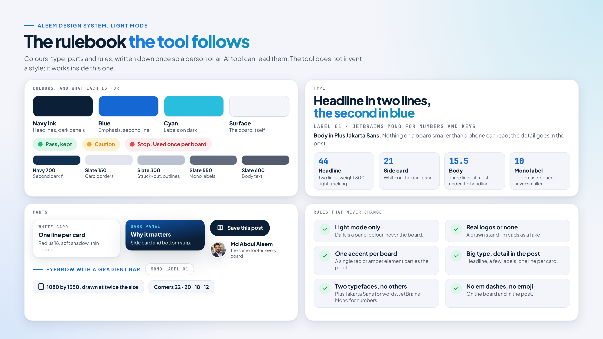
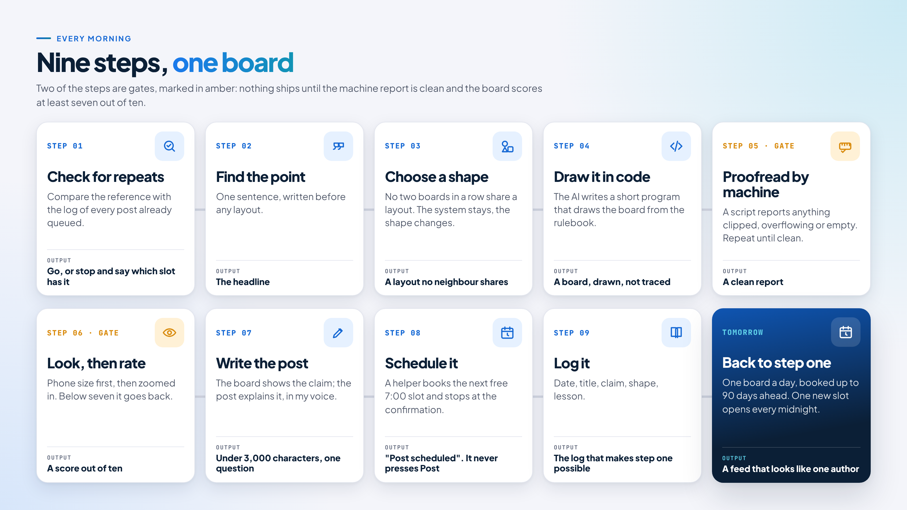
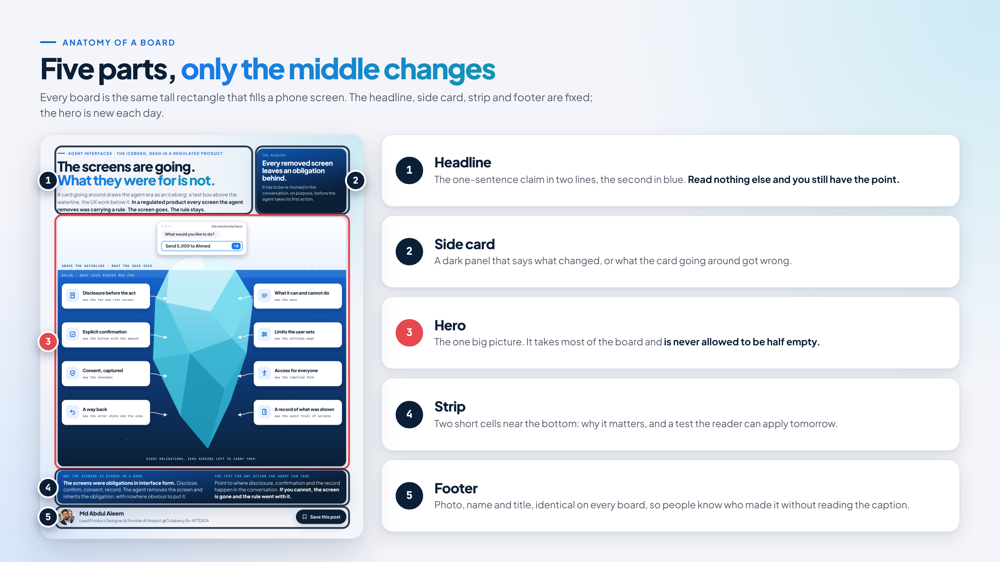
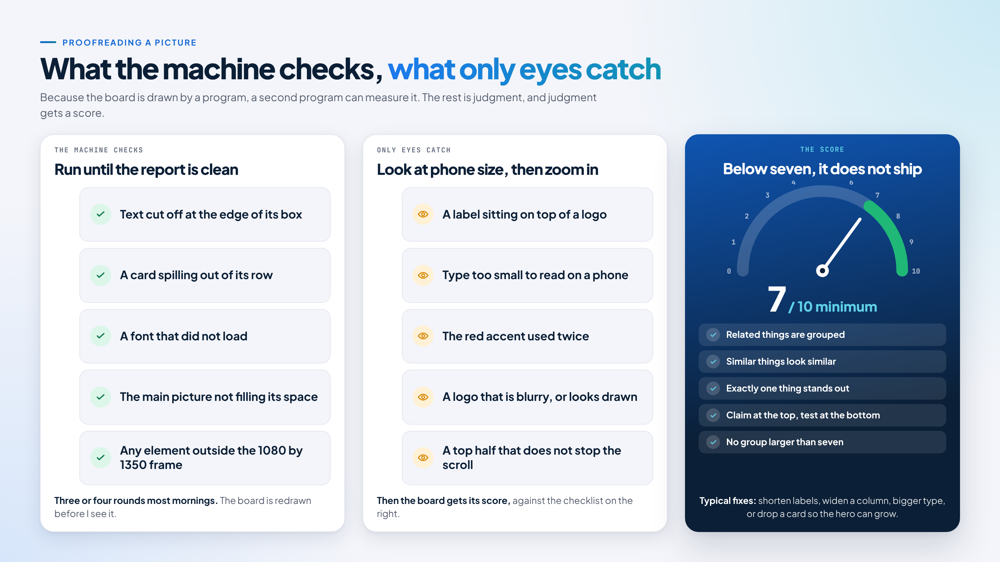
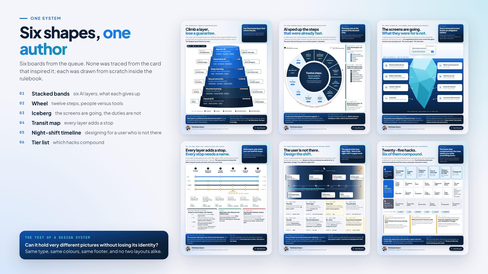

Since early October, a new infographic has gone out on my LinkedIn at 7:00 every morning. Each one is drawn in my own design system by an AI tool that follows a written rulebook, and each is checked by a script before I ever see it. This is how the routine works, written for people who do not code.

<Callout title="The short version">
One claim first, then the picture. A written rulebook the AI has to follow. A script that proofreads every board, a score out of ten, and nothing ships below seven. The tool schedules the post but never publishes it.
</Callout>

## Why I built a routine instead of posting when inspired

The people I want to reach, design and product leaders and the managers who hire them, notice a steady presence more than any single post. So I set myself a rule: one visual post a day at 7:00, booked as far ahead as LinkedIn allows, which is 90 days.

The obvious shortcut is to take an infographic that is doing well on LinkedIn and remake it in your own colours. I started there. After the first few rounds the boards had begun to look alike: the same grid of tiles, different words. And with ninety posts in the queue I could no longer hold the whole list in my head, so I was close to saying the same thing twice.

That was the point where a habit became a process. I wrote the design rules down so a tool could follow them, put a repeat check at the front of every morning, and added a mechanical check at the end so layout mistakes are caught before I see the picture. What comes out is still inspired by the card that started it, but it is recognisably mine.

## A card is a prompt, not a template

Every morning starts with a reference: an infographic going around LinkedIn, plus the text that came with it. I do not copy it. I read it for three things: what it claims, what it leaves out, and the one detail a designer who has worked in banking or enterprise software would notice first.

That reading becomes a single sentence, written before any layout. "Climb a layer, lose a guarantee." "The screens are going. What they were for is not." "The user is not there. Design the shift." The sentence is the headline of the board and the backbone of the post. If I cannot write it, there is no post that day.

The board keeps the reference's subject and sometimes, when I like it, its shape: a wheel, an iceberg, a funnel. Everything else is new: my claim, my colours and type, my footer. Facts on the original card are checked on the web before they are reused, and if one is wrong, the post corrects it rather than repeating it.



## The design system is the real secret

A design system sounds technical. It is a rulebook. Mine says which blues and navies I use and what each one is for, that headlines are set in one typeface and small labels in another, how rounded a card's corners are, how far apart things sit, and what the footer always says. It also says what I never do: no dark background for the whole board, no emoji, no invented logos.

The difference from a brand guide in a PDF is that mine is written in a form a tool can read as well as a person. When I ask the AI to draw a board, it does not invent a style. It picks up the rulebook and works inside it. That is why thirty boards with thirty different shapes still look like one author.

The whole rulebook is public: [Aleem Design System on GitHub](https://github.com/aleemcolaberry/Aleem-Design-System). It holds the colour and type tokens, the components, page and post templates, a light and a dark theme, and a small audit script that checks contrast and clipping before anything ships. The boards in this post use the light theme only.



I think this matters well beyond my LinkedIn feed. AI tools are now generating interfaces inside real products, and the only way those interfaces stay consistent and trustworthy is if the judgment that used to live in a designer's head is written down where the tool can read it. My daily post is a small test of that idea, run every morning.

## What the tool knows about me

The tool is only as good as what it knows about the person it writes for. In Claude, that context lives in a Project: a folder that holds instructions and reference files every conversation can see. Mine is called ProductDesign. It holds the design system kit, the post rules, my profile photo and the process notes, and it opens with the text below.

This is the exact context I entered, reproduced as written. It covers who I am, what I believe, how I write, the three kinds of work I ask for, and the standing instructions for generating an infographic.

```text
ABOUT ME
I'm Mohammed Abdul Aleem (Aleem), a Senior Product Designer based in Hyderabad with 12+ years across enterprise UX, fintech, SaaS, design systems and AI-enabled product work. Currently at Colaberry; previously NTT DATA, Teqsar Fintech, Click2Clinic, Ray SEO. Portfolio: aiuxaleem.com. LinkedIn: /in/aiuxaleem.

My north star: stay a designer at heart, but move from design execution toward influence. Defining problems, shaping products, building systems, guiding teams, using AI well, and contributing to business decisions. I'm targeting Senior / Lead / Principal Product Designer, AI Product Designer, Product Design Lead/Manager and AI Product roles, mainly in Saudi Arabia, UAE and Hyderabad.

WHAT I BELIEVE (use this as the point of view in my writing)
- Good design is problem solving, not decoration. Always ask why an experience exists, what problem it solves, and whether it scales.
- AI is changing what a product can be, not just how fast we design. Speed has to be balanced against trust, usability and consistency.
- Design systems should constrain AI-generated interfaces. Judgment that stays in someone's head doesn't scale; it has to be written down where people and AI tools can read it.
- Human judgment stays central in AI-assisted design. AI decisions need a visible reason and an easy override, or people stop trusting them.
- Map the system before designing screens, especially for agentic products: where does authority sit, and where can it fail?

HOW TO WRITE AS ME
- Credible, thoughtful senior designer voice aimed at hiring managers and design/product leaders. No hype, no buzzword stacking, no exaggerated or overly promotional claims.
- Plain, medium-length sentences. One idea per short paragraph. Contrast pairs and short two-line pivots are fine.
- Ground every claim in real work I've described. Never invent projects, numbers, employers, tools or results. If you need a detail you don't have, ask me.
- Use my metrics sparingly, only when a number genuinely strengthens the point.
- No em dashes, no emoji.
- Client confidentiality: never name client projects in public content (posts, comments, portfolio copy). Describe them generically, e.g. "an AI freight negotiation tool for a client."

WORKSTREAM 1: LINKEDIN POSTS AND COMMENTS
- Open with something concrete: a number, a specific observation from my work, or a named person's idea I'm responding to (credit them, then add my angle).
- Close posts with one direct question to readers. 2 to 3 hashtags at the end (e.g. \#AIUX, \#AIProductDesign, \#DesignSystems).
- Comments: start with the author's first name, 2 to 4 sentences, agree briefly then extend with a concrete angle from my experience. No hashtags.
- Vary the angle across pieces: enterprise and fintech UX, accessibility, business analysis, workflow mapping, AI agents and voice, trust in AI, design leadership and mentoring. Don't default to design systems every time.
- When useful, give me 2 to 3 hook options and a recommendation, then the full draft.

WORKSTREAM 2: JOB HUNTING AND RESUME TAILORING
When I paste a job description:
1. Briefly analyze it: seniority level, must-have vs nice-to-have skills, key keywords, and what the hiring manager is really worried about.
2. Show a fit assessment: where my experience matches strongly, where it's partial, and any real gaps. Be honest.
3. Tailor my resume (from the resume file in this project): rewrite the summary, reorder and reword bullets to match the role's language, and adjust the headline. Keep it ATS-friendly (standard headings, no tables or graphics, keywords used naturally).
4. Only rephrase and re-emphasize real experience. Never add skills, titles, dates or metrics I haven't given you. Flag anything that looks inconsistent (e.g. years of experience, job titles).
5. Offer a short cover letter or recruiter message if relevant.
For senior/lead roles, emphasize strategy, systems thinking, cross-functional influence and mentoring over pure UI execution.

WORKSTREAM 3: PORTFOLIO CASE STUDIES (aiuxaleem.com)
- Structure case studies around decisions, not deliverables: context and business problem, my role and team, constraints, research and insights, key decisions and trade-offs (and why), the outcome, and what I'd do differently.
- Show product thinking and how I worked with PMs, engineers and stakeholders, not just final screens.
- Before drafting, interview me with focused questions to pull out the real story and evidence. Don't fill gaps with assumptions.
- Keep client names and confidential details out; suggest how to anonymize.
- Write scannable copy: clear section headings, short paragraphs, and a one-line summary at the top for busy hiring managers.

GENERAL
- Be practical, detailed and actionable. Push back if an idea weakens my positioning or sounds generic.
- If a request is ambiguous, ask one focused question before writing.

--------- GENERATING INSTRUCTIONS
Instructions for infographic generate (whenever i ask you to generate infographic run these)

- you are an expert graphic designer for linkedin post, i need you to re-design attached image make sure the icons and images are intact if they need to be otherwise you can design new by taking inspiration layout should be bento style.
- dont make any mistakes like text overflow etc
- most importantly above the fold should be eye catching and hero should never be half empty
- the design language should be Aleem Design System light mode,
- in the end allow me to downloan in .png without any design issues, text overflow issues, any kind of design issues. (make sure you check your work before giving me .png file here in chat)

- in footer give my details and use my DP from your memory if not ask me to upload, also branding should be ours not the reference image
- Md Abdul Aleem
- Lead AI Product Designer @Colaberry

-run this Audit Prompts after generating
- do you really think you have done a good job? check your work and improve above the fold design always give me finished files to downloan here in chat
- on a scale of 1 to 10 how good do you think you have generated the result, if rating is low try your best to improve the rating and give me best results only

check your work against Laws of UX and give rating to your results on a scale of 1-10 rating, if you get below 7 rating try your best to improve it.
```

Two things in that text do most of the work. The beliefs section gives the tool a point of view, so a post argues something rather than summarising the card. The "never invent" lines keep it honest when it is tempted to fill a gap with a plausible story.

## The routine, nine steps every morning

1.  **Check for repeats.** Before anything is drawn, the reference is compared with a log of every post already in the queue: topic, claim and shape. If I have made the point before, I stop. Sometimes I go ahead anyway, but only with a claim that is not already queued, never a second version of the same argument.

2.  **Find the point.** One sentence, written before any layout. It becomes the headline.

3.  **Choose a shape.** No two consecutive boards share a layout. Wheels, timelines, icebergs, transit maps, tier lists, a browser window, a night shift. The system stays the same; the shape changes.

4.  **Draw it in code.** The AI assistant I work with (Claude) writes a short program that draws the board, taking colours, type and the footer from the rulebook. Logos are real ones. If a real logo is not available, the brand is written in words rather than given an invented mark.

5.  **Proofread by machine.** A script renders the board at twice the size LinkedIn needs and reports anything clipped, overflowing or empty. It runs again until the report is clean.

6.  **Look, then rate.** I look at the board the way a reader will, on a phone, and ask three questions: does the top half stop the scroll, is the main picture full, can every word be read. The board gets a score out of ten. Below seven, it goes back.

7.  **Write the post.** The board shows only the headline, a few labels and one line per card. The explanation goes in the post, in my voice, under 3,000 characters, ending with one question for readers.

8.  **Schedule it.** A second AI helper opens LinkedIn in my browser, attaches the image, pastes the text, books the next free 7:00 slot and stops at the "Post scheduled" message. It never presses Post and never handles a password.

9.  **Log it.** Date, title, claim, shape and anything learned go into the log, which is what makes step one possible tomorrow.



## Anatomy of a board

Every board is the same size, a tall rectangle that fills a phone screen, and every one is built from the same five parts. Only the middle changes.

- **Headline.** The one-sentence claim, in two lines, with the second line in blue. If you read nothing else, you have the point.

- **Side card.** A dark panel next to the headline that says what changed, or what the card going around got wrong.

- **Hero.** The one big picture: the wheel, the iceberg, the timeline. It takes most of the board and is never allowed to be half empty.

- **Strip.** A dark band near the bottom with two short cells: why it matters, and a test the reader can apply tomorrow.

- **Footer.** My photo, my name and my title, the same on every board. People should know who made it without reading the caption.

The rule that governs all of it: nobody reads small text on a feed. The board carries the headline, a handful of labels and at most one line per card, all in large type. Anything that needs a sentence goes in the post underneath.



## Proofreading a picture

A spell checker finds typos. I wanted the same thing for layout. Because each board is drawn by a program, a second program can measure it: is any text cut off, does any card spill out of its box, did the fonts load, does the main picture fill the space the headline left for it. If anything fails, the board is redrawn before I look at it. Most mornings this takes three or four rounds.

Some mistakes are invisible to a script. A label sitting on top of a logo. A word that is inside its box but too small to read on a phone. A red highlight used twice, so neither stands out. A logo that is blurry, or worse, one that looks drawn rather than real. Those I catch by looking, first at the size LinkedIn shows, then zoomed in on the busy areas.

Then I score the board against a short checklist borrowed from the Laws of UX: are related things grouped, do similar things look similar, is there exactly one thing that stands out, is the claim at the top and the test at the bottom, is nothing grouped in more than seven. The score is out of ten. Below seven, it does not ship. I shorten labels, widen a column, make the type bigger, or remove a card so the main picture can grow.



## The rules that keep it honest

A process that can produce a polished board every day can also produce a polished mistake every day. These rules are fixed, and the tool is told them every time.

- **Real logos or none.** A logo is cropped from a real source or left out. A drawn stand-in for a brand mark reads as a fake, because it is one.

- **Never name the person I borrowed from.** The reference is described, not credited by name, unless I am deliberately responding to someone's idea. Brands and published books are fine to name.

- **Never invent my own story.** The post says "I would" unless I have actually done the thing. No made-up projects, numbers or results, and no client names, ever.

- **Check the facts on the card.** Prices, licence terms, regulator names and product features are verified before they are reused.

- **No links, no "see comments".** The post has to stand on its own with the image.

- **Big type only.** If a word needs to be small to fit, it does not belong on the board.

- **One accent per board.** A single red or amber element carries the point. Everything else stays in navy, blue and grey.

- **The tool never posts.** It schedules, and it stops at the confirmation. Publishing is a human decision, even when the human is only deciding not to intervene.

## One system, many shapes

The best test of a design system is whether it can hold very different pictures without losing its identity. Below are six boards from the queue: stacked bands, a wheel, an iceberg, a transit map, a night-shift timeline and a tier list. Different subjects, different shapes, one author.



None of them was traced from the card that inspired it. Each was drawn from scratch inside the rulebook, which is why they belong together even though no two share a layout.

## The tools and resources I use

Nothing here is custom software. Everything is public, and most of it is free.

| Resource                             | What I use it for                                                                                                                                                                                   | Where                                                                                                                                        |
|--------------------------------------|-----------------------------------------------------------------------------------------------------------------------------------------------------------------------------------------------------|----------------------------------------------------------------------------------------------------------------------------------------------|
| Claude, with a Project               | Drawing the boards, writing the posts, running the checks, and holding the context above so every conversation starts informed                                                                      | [claude.ai](https://claude.ai)                                                                                                               |
| Aleem Design System                  | The rulebook: colour and type tokens, components, templates, light and dark themes, and an audit script for contrast and clipping                                                                   | [github.com/aleemcolaberry/Aleem-Design-System](https://github.com/aleemcolaberry/Aleem-Design-System)                                       |
| linkedin-skills (open source, MIT)   | Twelve LinkedIn skills for Claude by sergebulaev. I use Post Writer for the hook and structure, and Humanizer to strip the patterns that make a post read as machine-written before it is scheduled | [github.com/sergebulaev/linkedin-skills](https://github.com/sergebulaev/linkedin-skills)                                                     |
| Laws of UX                           | The checklist behind the score out of ten: grouping, similarity, one thing that stands out, position, no more than seven                                                                            | [lawsofux.com](https://lawsofux.com)                                                                                                         |
| Plus Jakarta Sans and JetBrains Mono | The two typefaces on every board, both free                                                                                                                                                         | [Plus Jakarta Sans](https://fonts.google.com/specimen/Plus+Jakarta+Sans), [JetBrains Mono](https://fonts.google.com/specimen/JetBrains+Mono) |
| LinkedIn's own scheduler             | Booking one post a day at 7:00, up to 90 days ahead                                                                                                                                                 | In the post composer                                                                                                                         |

The two that matter most are the first two. The design system is what makes the output mine, and the Project is what makes it informed. The rest are good tools that would work for anyone.

## What I learned

**The claim comes before the picture.** Every time I let the layout lead, I got a prettier copy of someone else's card. One sentence first, then the shape.

**Write the rules down, or they do not scale.** A design system in my head produced four boards that looked the same. A design system in a file the tool can read produced thirty that look like one author and no two alike.

**Check for repeats with evidence, not memory.** A log that says "this is the fourth tool-stack post, and the one on the 28th already argues the opposite" is what lets me skip, or override on purpose.

**Let a machine proofread, then look anyway.** The script catches what is cut off. Only eyes catch what is unreadable.

**Big type on the board, detail in the post.** The split is what makes a dense subject readable on a phone, and it is the rule I break most often when I am in a hurry.

**Real marks or none.** A fake logo costs more trust than a missing one.

None of this needs code to copy. A written rulebook, a repeat check, one claim per post and an honest score out of ten would improve most feeds, with or without an AI in the loop.

If you publish regularly, what is the one rule you would write down first so a tool, or a colleague, could follow it without asking you?
